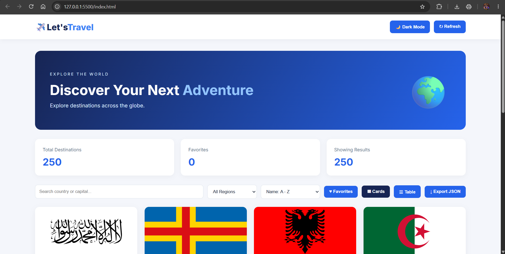
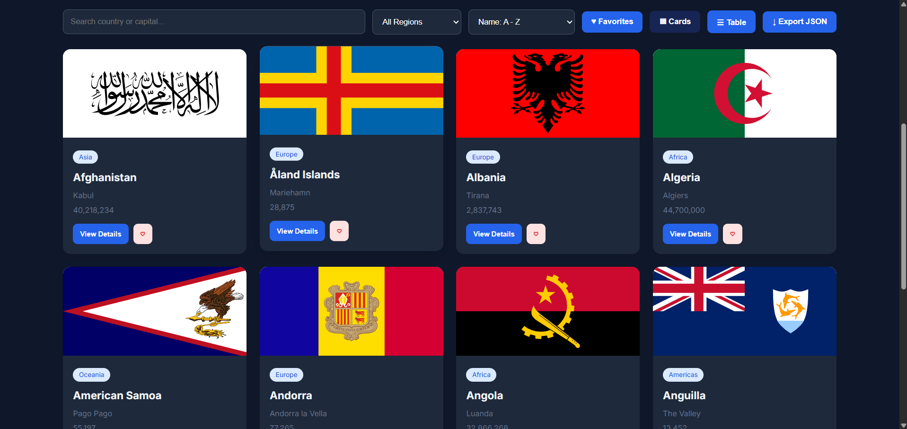
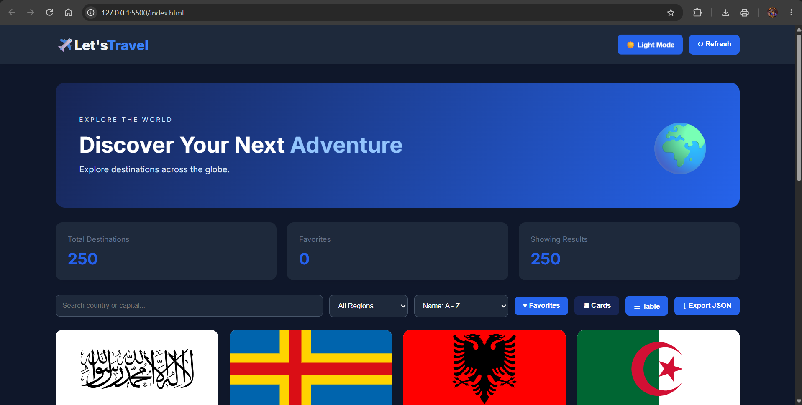
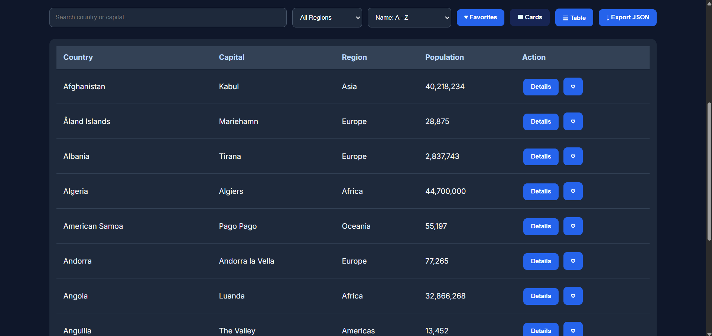
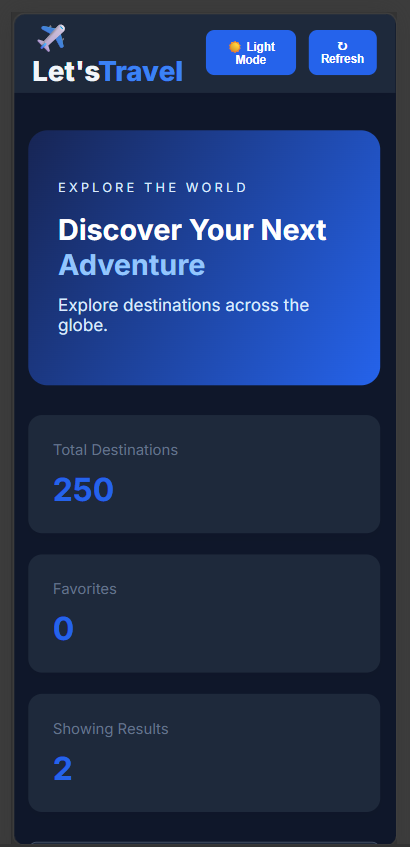

# Let's Travel – Destination Dashboard

## Project Overview
Let's Travel is a responsive Travel Destination Dashboard developed using JavaScript ES6 features. It displays country information using a public REST API.

## Features
- Fetch country data using Fetch API.
- Search destinations by country name.
- Filter destinations by region.
- Sort destinations.
- Grid View and Table View.
- View country details in a modal.
- Dark Mode and Light Mode.
- Favorites functionality.
- Local Storage.
- Pagination.
- Export data as JSON.
- Loading State.
- Error State.
- Empty State.
- Toast Notifications.
- Responsive Design.

## Technologies Used
- HTML5
- CSS3
- JavaScript ES6
- Fetch API
- Countries.dev REST API
- Local Storage

## JavaScript Concepts Used
- let and const
- Arrow Functions
- Template Literals
- Destructuring
- Spread Operator
- Rest Operator
- Default Parameters
- ES6 Modules
- Classes and Objects
- Promises
- Async/Await
- Fetch API

## API Used
Countries.dev API

https://countries.dev/

## Project Structure

```text
Day-06-ES6-JavaScript/
│
├── assets/
│   ├── icons/
│   └── images/
│
├── css/
│   └── style.css
│
├── js/
│   ├── api.js
│   ├── app.js
│   └── utils.js
│
├── screenshots/
│
├── index.html
│
└── README.md
```

## How to Run
1. Open the project folder in Visual Studio Code.
2. Open index.html.
3. Run the project using Live Server.
4. The dashboard will fetch country data from the API.

## Screenshots

### Main Dashboard


### Cards View


### Dark Mode


### Table View


### Mobile screen view


## Internship Details
**Program:** APEX LARK Full Stack Development Internship Program

**Day:** 05

**Topic:** ES6 JavaScript Features – Modules, Promises, Async/Await & Fetch API

